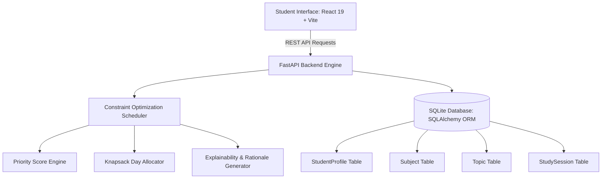

# StudySync AI – Intelligent Personalised Study Planner
> **VIT AI Innovate-A-Thon 2026 — Problem Statement 7: Personalised Study Planner**

[]()
[]()
[]()
[]()
[]()

---

## 1. Executive Summary & Problem Context
In modern competitive universities and rigorous academic environments, students frequently suffer from cognitive overload, cramming, burnout, and last-minute panic. Standard static timetable generators schedule uniform blocks of time, ignoring critical variables:
- **Topic-Level Mastery:** How well the student actually understands each subject module.
- **Curricular Importance:** Syllabus weightage and assessment point distribution.
- **Dynamic Availability:** Real daily fluctuating study capacity (e.g., weekdays vs weekends).
- **Assessment Deadlines:** Approaching mid-term, end-semester, or competitive milestones.

**StudySync AI** solves this problem by delivering a **mathematically provable, multi-objective constrained study scheduling engine** combined with **explainable AI (XAI)** and **pedagogical spaced repetition**.

---

## 2. Transparent AI Architecture (Optimization vs. Machine Learning)
In strict accordance with ethical engineering and hackathon criteria:
> **StudySync AI** does not mislabel deterministic heuristics as "deep learning". Instead, the engine operates on **Multi-Criteria Mathematical Optimization & Constrained Knapsack Allocation**.

### Priority Formulation Formula
For each topic $t$ belonging to subject $S$:

$$P(t) = \Big( w_m \cdot M_{\text{deficit}}(t) + w_i \cdot I_{\text{norm}}(t) + w_u \cdot U(t) \Big) \times 100$$

Where:
1. **Mastery Deficit ($w_m = 0.45$):**
   $$M_{\text{deficit}}(t) = \frac{5 - \text{Mastery}(t)}{4} \in [0.0, 1.0]$$
   A student with mastery $1/5$ has maximal deficit ($1.0$), contributing $+45.0$ points to priority.
2. **Curricular Importance ($w_i = 0.30$):**
   $$I_{\text{norm}}(t) = \frac{\text{Importance}(t) - 1}{4} \in [0.0, 1.0]$$
   Topics with $5/5$ importance contribute $+30.0$ points to priority.
3. **Assessment Urgency ($w_u = 0.25$):**
   Decays with days remaining to assessment:
   - $\le 2\text{ days}: U = 0.95$ ($+23.75$ points)
   - $3\text{--}4\text{ days}: U = 0.80$ ($+20.0$ points)
   - $5\text{--}7\text{ days}: U = 0.65$ ($+16.25$ points)
   - $> 14\text{ days}: U = 0.30$ ($+7.5$ points)

### Hard Invariant Constraints
- **Daily Availability Constraint:**
  $$\sum_{s \in \text{Day } d} \text{Duration}(s) \le \text{AvailableHours}(d)$$
  Scheduled hours strictly *never* exceed student availability.
- **Deadline Cutoff Constraint:**
  $$\text{Date}(s) \le \text{AssessmentDate}(\text{Subject}(t))$$
  No session is ever scheduled after the topic's exam date.
- **History Preservation Invariant:**
  When a student marks a session completed or updates topic mastery, the scheduler **locks and preserves completed sessions**, recalculating only future uncompleted slots.

---

## 3. Pedagogical Phase Breakdown
Unlike naive schedulers that schedule repetitive blocks, StudySync AI structures learning into three cognitive phases:
1. **Concept Foundation (Deep Study):** Required when topic mastery is $\le 3$. Focuses on core theory, derivations, and foundational notes.
2. **Applied Problem Practice (Practice):** Scaled to syllabus importance. Focuses on solving exercises, coding challenges, and past exam questions.
3. **High-Yield Spaced Revision (Revision):** Automatically placed in the final $1\text{--}3$ days prior to the assessment milestone to combat the Ebbinghaus forgetting curve.

---

## 4. System Architecture


---

## 5. Technology Stack
- **Frontend:**
  - React 19 + Vite 6
  - Tailwind CSS v4 (Royal Indigo & Violet theme with custom glassmorphism)
  - Framer Motion (Micro-animations and transitions)
  - Recharts (Interactive workload progression, pie charts, and mastery progress)
  - Canvas Confetti (Positive behavioral reinforcement)
  - Lucide React (Semantic icons)
- **Backend:**
  - Python 3.13 + FastAPI
  - SQLite (Local ACID-compliant persistent database)
  - SQLAlchemy 2.0 (Relational ORM)
  - Pydantic v2 (Validation schemas)
  - Pytest (Automated invariant verification test suite)
  - Uvicorn (ASGI web server)

---

## 6. Pre-Configured Demo Personas
To evaluate different real-world scenarios, StudySync AI includes three distinct student personas accessible from the top navigation dropdown:

| Persona | Student Name | Profile & Constraints | Tested Scenario |
| :--- | :--- | :--- | :--- |
| **Beginner** | **Govind Innani** | Low mastery ($1\text{--}2/5$), tight daily hours ($2.0\text{h/day}$), exam in 5 days | Handles heavy deficit without exceeding strict daily limits; prioritizes high-yield concepts |
| **Intermediate** | **Lakshy Kesharwani** | Mixed mastery ($2\text{--}4/5$), moderate availability ($3.5\text{--}4.5\text{h/day}$), 3 exams | Interleaves multiple subjects; phases Concept Study $\to$ Practice $\to$ Spaced Revision |
| **Advanced** | **Adhiranshu Singh** | High mastery ($4\text{--}5/5$), approaching competitive exams ($4\text{--}5\text{h/day}$) | Prioritizes high-yield problem solving and revision near deadlines; zero post-exam sessions |

---

## 7. Verification & Automated Test Suite
The backend contains a dedicated `pytest` suite in `backend/tests/test_scheduler.py` verifying all 6 invariants:

1. `test_priority_score_calculation`: Asserts that low mastery, high importance, near deadline topics receive score $\ge 80/100$.
2. `test_scheduled_hours_never_exceed_daily_availability`: Asserts daily scheduled minutes never exceed available capacity.
3. `test_no_sessions_occur_after_assessment_deadline`: Asserts zero sessions are placed past assessment deadlines.
4. `test_high_priority_topics_receive_more_attention`: Asserts novice topics receive more allocated study time than mastered topics.
5. `test_completed_sessions_preserved_during_rescheduling`: Asserts that marked completed sessions are locked and never deleted during dynamic recalculations.
6. `test_insufficient_time_deficit_handling`: Asserts capacity deficit flag and actionable warning alerts when study requirements exceed available hours.

### Running Tests from Command Line
```powershell
.\venv\Scripts\python -m pytest backend\tests\test_scheduler.py -v
```

### Running Tests from the In-App Web Interface
Navigate to the **"Test Suite & Evaluation"** tab in the sidebar and click **"Run Automated Test Suite"** to execute the tests in real time and view live output.

---

## 8. Local Setup & Execution Guide

### Prerequisites
- Python 3.10+ (Python 3.13 tested)
- Node.js 18+ (Node.js v22 tested)

### Step 1: Start Backend (FastAPI on Port 8000)
```powershell
# From project root directory
.\venv\Scripts\python -m uvicorn backend.main:app --host 127.0.0.1 --port 8000
```
- API Docs: `http://127.0.0.1:8000/docs`
- Health Check: `http://127.0.0.1:8000/api/health`

### Step 2: Start Frontend (Vite on Port 5173)
```powershell
# In a new terminal window
cd frontend
npm.cmd run dev -- --host 127.0.0.1 --port 5173
```
- Open in Browser: `http://127.0.0.1:5173`

---

## 9. Alignment with UN SDG 4: Quality Education
- **Target 4.4 (Skills for Employment):** Equips students with cognitive mastery in technical, STEM, and competitive curricula.
- **Target 4.7 (Equitable Learning):** Provides executive-level personalized study planning to every student, democratizing learning guidance without expensive commercial tutoring fees.
- **Student Mental Health & Burnout Prevention:** By strictly capping daily study hours and generating realistic schedules, StudySync AI prevents academic burnout and despair.

---

## 10. Known Limitations & Future Roadmap
- **Current State:** Single-user local SQLite database with weekday availability modeling and self-assessed mastery.
- **Next Version:**
  - Two-way synchronization with Google Calendar & Outlook.
  - Integration with Canvas / Moodle LMS for automatic assignment deadline ingestion.
  - Bayesian Knowledge Tracing (BKT) to dynamically infer mastery from quiz test scores.

---
*Developed for the VIT AI Innovate-A-Thon 2026 • Problem Statement 7: Personalised Study Planner.*
